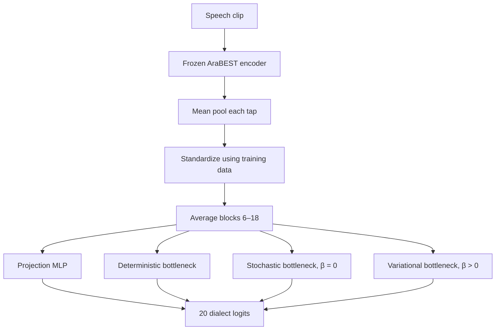

# Architectures

## Shared AraBEST representation

The research notebooks use frozen [AraBEST-RQ-300M-6k](https://huggingface.co/Elyadata/AraBEST-RQ-300M-6k) at revision `dff453e2b5f72f76211a523b1050691967e5a59b`. Audio is mono at 16 kHz. The pooled cache holds 26 taps, each with 848 dimensions. These taps cover the front end, 24 Conformer blocks, and the final normalization. E11 uses a uniform average of blocks 6–18 after standardizing each layer and coordinate with ADI-20 training statistics.

## E11 controls

| Head | Representation and objective |
| --- | --- |
| Projection MLP | Practical nonlinear classifier reference trained with cross-entropy |
| Deterministic bottleneck | One latent vector per clip, with the same width as the variational comparison |
| Stochastic bottleneck, β = 0 | Diagonal Gaussian posterior sampled during training, with cross-entropy |
| Variational bottleneck, β > 0 | Same stochastic head with a KL penalty to a standard normal prior |

Both stochastic heads use the posterior mean for prediction. The expected KL upper-bounds the input information in the sampled latent. The within-dialect AUROC measures separation for a source-fitted distance score in the inference representation. [The paper](../paper/main.tex) gives the derivation and explains the diagnostic.

## Earlier classifiers and probes

| Architecture | Implementation and role |
| --- | --- |
| MFCC + SVM | [CPU baseline](mfcc_svm_baseline.md) with pooled cepstral summaries and a classical classifier |
| Frozen AraBEST + linear | [Acoustic reference](acoustic_classifier.md) using the final mean-pooled tap |
| Layer probes and learned mixtures | [Single-layer probes and softmax-weighted mixtures](layer_mixture.md). The earlier scaling runs used a learned middle-layer mixture |
| Residual adapter | [Pilot notebook](../notebooks/pilots/Ali_Residual_Adapter_Colab.ipynb) compares a linear head with low-rank adapters with and without a skip connection |
| Jais direct tagging | [Baseline](jais_pilot.md) generates a dialect tag with the Jais speech model |
| Jais transcripts + TF-IDF | [Text baseline](transcript_tfidf.md) uses word/character TF-IDF and logistic regression |
| Acoustic–text fusion | [Balanced-cohort notebook](../notebooks/pilots/ADI20_4K_8K_Casablanca_Fusion_Kaggle.ipynb) combines the audio log-probabilities with 1.3 times the text log-probabilities. Missing usable text falls back to the audio scores |
| Attention pooling and fine-tuning | [A/B/C prototype](https://github.com/alizbeeb5/Arabic-Dialect-Identification/pull/18) contains frozen mean pooling, frozen masked attention with an MLP, and the same attention head with a trainable encoder. The branch reports implementation checks and has no full-data dialect score |
| Binary verifier | [Earlier proposed comparison](verifier_experiment.md). E11 is the current research focus |

Layer probes measure what a chosen classifier can recover. Nonlinear layers can make a cue more accessible to a linear probe even as total information cannot increase along the encoder. A learned mixture can approximate any of its single-layer probes by concentrating on one layer. Its performance on held-out corpora remains an empirical question.
