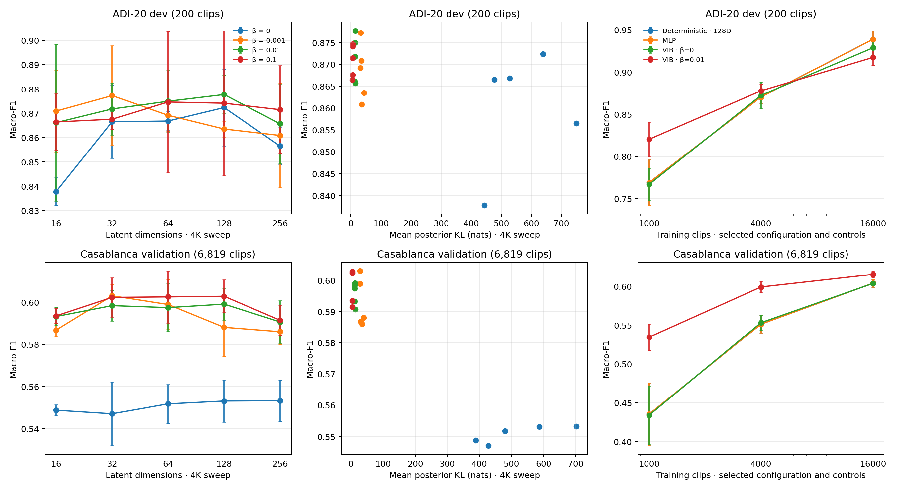

# E11 variational bottleneck

Does KL regularization help a frozen AraBEST dialect classifier transfer when labeled audio is scarce? Across all three training sizes and seeds, the KL-regularized head improved macro-F1 on full Casablanca relative to the same-width stochastic control. The mean gain was largest at 1K labels.

## Comparison

The encoder is frozen. Every matched arm uses the same fixed mean of AraBEST layers 6–18, training-only standardization, clip assignments, and 1,000 head updates per seed. The variational head samples during training and uses the posterior mean at evaluation. A 4K sweep over five widths and four KL weights selected 128 dimensions and β = 0.01 using mean ADI-20 development macro-F1 across seeds 490, 491, and 492, among positive β values. The selected configuration then went to the 1K and 16K comparisons. Casablanca contributed no training or selection clips in E11.

The ADI-20 development pilot has 200 clips. Full Casablanca validation has 6,819 reference clips, of which 6,818 produced predictions. The unavailable clip remains in the denominator. Casablanca macro-F1 averages over its eight reference dialects and the model can predict any of the 20 ADI-20 labels. Treat Casablanca as external development because the team previously evaluated on it.

| Labeled clips | ADI-20 dev VIB macro-F1 | ADI-20 dev Δ vs β = 0 | Casablanca VIB macro-F1 | Casablanca Δ vs β = 0, mean ± SD | Casablanca Δ vs deterministic, mean ± SD |
| ---: | ---: | ---: | ---: | ---: | ---: |
| 1,000 | 0.8202 | +5.34 pp | 0.5344 | +10.07 ± 2.81 pp | +9.93 ± 3.12 pp |
| 4,000 | 0.8777 | +0.54 pp | 0.5991 | +4.60 ± 0.57 pp | +4.79 ± 0.54 pp |
| 16,000 | 0.9172 | −1.14 pp | 0.6153 | +1.17 ± 0.28 pp | +1.14 ± 0.08 pp |

The projection MLP and 128-dimensional deterministic control produced identical predictions on both cohorts for every matched seed and training size. They represent the same baseline outcome. The learned-layer-mixture [scaling run](../README.md#frozen-arabest-scaling) reached 0.6544 macro-F1 on full Casablanca with 16K labels under a separate acoustic recipe.

## Interpretation

At 1K, the comparison against the stochastic β = 0 head isolates the contribution of the KL term under the tested recipe. The largest per-dialect gains were in Algerian (+29.33 points) and Moroccan (+26.78 points). The transfer gain narrowed at 16K, where ADI-20 development macro-F1 also went down relative to the unregularized head.

The within-dialect diagnostic fits a distance score on ADI-20 training features. It measures how well that score separates corpora on shared-dialect ADI-20 development and Casablanca, before and after the head. The macro separability score for the selected arm changed from 0.804 to 0.803 at 1K, from 0.804 to 0.804 at 4K, and from 0.803 to 0.820 at 16K. Relative to the β = 0 latent, separability was lower at 1K (0.803 vs 0.817) and higher at 16K (0.820 vs 0.792). The transfer gain does not consistently track a reduction in detectable corpus separation. These scores characterize one diagnostic and do not estimate mutual information directly.

## Evidence

- [Run protocol](protocol.json) and [selection record](selection.json) identify the code, encoder, cohorts, optimizer budget, and selection rule.
- [Per-seed metrics](metrics_per_seed.csv), [paired deltas](paired_deltas_per_seed.csv), [paired summary](paired_deltas_summary.csv), and [per-dialect F1](per_dialect_f1_per_seed.csv) document the two primary evaluation modes. Timing refers to classifier fitting. The notebook reports feature extraction separately.
- [4K sweep](4k_dev_sweep.csv), [domain summary](domain_summary.csv), and [domain scores by dialect](domain_by_seed_and_dialect.csv) support the compression and corpus analysis.
- All 204 primary accuracy and macro-F1 entries were recomputed from the archived prediction rows before publication.

Run EXP-02 and EXP-04 next. The first follow-up is a matched 1K rerun using the strongest single AraBEST layer selected on ADI-20 development. See the [experiment plan](../../docs/future_experiments.md).
