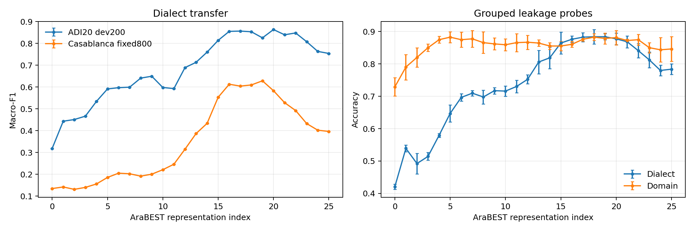

# AraBEST layer and corpus probes

EXP-02 asks which frozen AraBEST representations make dialect information accessible to a linear classifier. EXP-04 asks how well a grouped linear probe can distinguish ADI-20 from Casablanca within the shared dialects.

## EXP-02 layer selection

The single-layer probes used the same fixed 4,000 labeled training clips and the same frozen encoder. We selected the single layer by 20-way macro-F1 on the 200-clip ADI-20 development pilot.

| Single AraBEST layer | ADI-20 dev macro-F1 | Balanced Casablanca macro-F1 |
| --- | ---: | ---: |
| Conformer 20 | **0.8638** | 0.5832 |
| Conformer 19 | 0.8257 | **0.6285** |

Casablanca contains 800 balanced validation clips. Models may predict any of the 20 labels, and macro-F1 averages across the eight reference dialects. The selected single layer is Conformer 20. The single-layer fits used identical training assignments across the reported seed entries and returned identical scores.

## EXP-04 corpus probe

For each seed, the fit and holdout contained 768 and 256 clips respectively, balanced across all 16 combinations of corpus and dialect. The exported group IDs were disjoint between fit and holdout within each seed. Recording-group metadata was available for 50% of the clips in the exported splits.

The corpus probe recovered corpus labels from Conformer 20 with **88.15% mean accuracy** (2.22 pp SD), versus a 50% balanced chance baseline. This shows that the grouped linear probe can recover corpus cues on that tap. E11’s source-fitted distance diagnostic uses a different protocol.

## Next ablation

Use Conformer 20 as the input to the 128-dimensional stochastic E11 head. At 1K labels, compare β = 0.01 against β = 0 using the original training draws, three seeds, update budget, and full 6,819-clip Casablanca cohort. Compare the paired difference with the original +10.07-point gain obtained using the layers 6–18 average.

## Evidence

- [Layer selection](layer_selection.json), [run protocol](protocol.json), [summary](metrics_summary.csv), and [per-seed metrics](metrics_per_seed.csv).
- Verified all 849 exported accuracy and macro-F1 values against their prediction rows and checked balance and group separation in the three EXP-04 splits.
